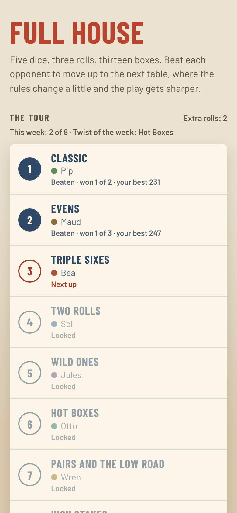
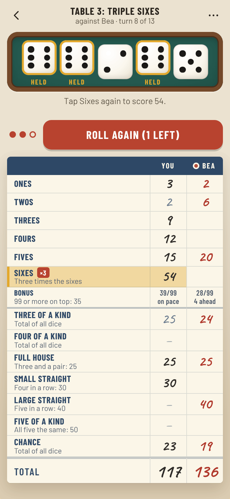
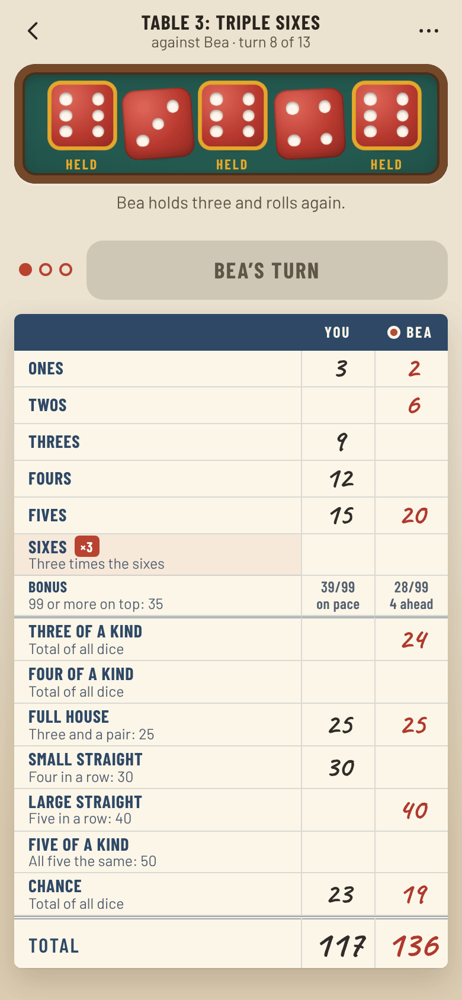
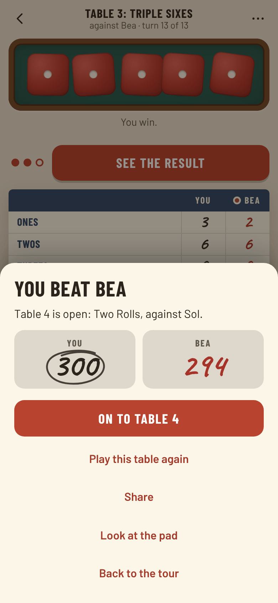

# Full House

**Play it: [full-house.junkdrawer.works](https://full-house.junkdrawer.works/)**

**A five-dice game against a ladder of eight opponents, each sharper than the last, on tables that change the rules.** Roll in the felt tray, hold what you like, and pencil your score into the pad beside your opponent's. Beat an opponent to move up a table: Evens in place of Ones, Sixes that score three times over, two-roll turns, wild ones, and on up to the Dealer.

<p align="center">
  
  &nbsp;
  
</p>
<p align="center">
  
  &nbsp;
  
</p>

## How it plays

- **Five dice, three rolls, thirteen boxes.** Hold any dice between rolls, then fill one box a turn: the six number boxes on top (63 or more earns a 35-point bonus), then three and four of a kind, a full house, small and large straights, five of a kind and chance. Every five of a kind after the first is worth 100 more (unless Five of a kind holds a 0), and has to go in its own number's box if that's open, or else any box in the bottom section, where a full house or a straight counts in full.
- **Pick, then score.** Tap a box to pick it and tap it again to write it in, so a slip of the thumb doesn't cost you a box. After each roll the open boxes show what the dice would score there (a light dash where they'd score nothing), unless you turn that off. Under the bonus so far (30/63), small print says whether each column is on pace for it: against three of each number in the boxes filled, scaled to the table's own target, on pace, 2 ahead or 6 behind.
- **The tour.** Eight tables, in order, each with its own twist and its own opponent (a tap on one not yet open shows its card, and who to beat to sit there):
  1. **Classic** against Pip, who keeps whatever there's most of.
  2. **Evens** against Maud: the Ones box is gone, Evens adds up every even die instead, and the bonus needs 72.
  3. **Triple Sixes** against Bea: the Sixes box scores three times over, and the bonus needs 99.
  4. **Two Rolls** against Sol: two rolls a turn instead of three, and the bonus needs 52.
  5. **Wild Ones** against Jules: in the bottom section, a 1 (tagged Wild on the dice) counts as whatever number scores best, though the extra 100 for another five of a kind needs five dice showing the same number.
  6. **Hot Boxes** against Otto: two boxes, picked at random each time you sit down (never Ones or Five of a kind), score three times over; when one is a number box, the bonus rises to match.
  7. **Pairs and the Low Road** against Wren: Two pairs (four of one number count) replaces three of a kind, and the Low road (30 for a total of 12 or less) replaces chance.
  8. **High Stakes** against the Dealer: four rolls a turn, and the bottom section scores double, though the extra for another five of a kind stays at 100.
- **Opponents who plan.** Five dice can only land 252 different ways, so an opponent works out, for every possible roll, which dice to keep for the best result over the rest of its turn. It values each box by what it scores now, what it might be worth later, and the top-section bonus. The early opponents leave parts of that out and make mistakes on purpose, though only close calls a person might get wrong. Past Pip, the further up the tour, the more patient an opponent is and the fewer slips it makes. On classic rules Pip averages about 151, and the Dealer about 244 (`node dev/strength.mjs 600 classic`); the best possible play averages 254.59 (Tom Verhoeff, *Optimal Solitaire Yahtzee Player*, Eindhoven University of Technology, 1999).
- **Watch them play.** Their red dice tumble in your tray and their scores go into the pad in red pencil. Tap the dice to hurry a turn along, or choose Quick in the game's menu, or Just their score to see only where their dice end up and what they score.
- **The result.** Who won and, when it wasn't within 20 points, the biggest gap between the two cards in one line: the top section, the bonus, five of a kind or the rest of the bottom section ("Maud got the 35 bonus; you were 9 short."). Look at the pad puts the result aside to read the finished pad, and See the result brings it back.
- **Quick game.** Classic rules against anyone you've met on the tour, once you've beaten Pip at table 1. Once you've beaten two tables, the rules of any table you've beaten instead, if you choose (the header says which: Quick game: Wild Ones). Quick games never count on the tour.
- **Your progress.** Each table's line on the tour says whether you've beaten it, the games you've won and played there (or lost, until you beat it), and your best score there; Quick game says how many of those you've won. Giving up part way counts as a loss. Beat the Dealer and the tour is finished: a tick pencilled on each table, and your best at each added up at the foot of the card, a total to beat.
- **On a keyboard,** Space or R rolls and 1 to 5 hold the dice. Tab reaches the boxes, the arrows go between them, and Enter picks one, then scores it. Space or Enter hurries the opponent along. How to play says so on a computer, and Keyboard shortcuts in the game's menu turns the single keys off.
- No ads, no account and no server. Your progress and any game in progress stay in your browser. It works offline and installs to a phone's home screen.

## Running it

It's a static site: plain HTML, CSS and JavaScript, with no build step.

```sh
npm start                      # serves it at http://localhost:8086 (or use any static file server)
npm install                    # once, for the bundler and the screenshot tool's PNG compressor
npm test                       # the rules and the opponents in Node, then the game played in Chromium, the one-file build too (needs Playwright, and npm install)
node tools/screenshots.mjs     # redraws docs/*.png and og.png
node tools/make-icons.mjs      # redraws the PNG icons from icon.svg, the same to the byte every time
npm run build                  # bundles everything into dist/full-house.html, one file you can send around, and dist/artifact.html
node dev/strength.mjs 300 all  # how each opponent scores at its own table, against the best settings, each mean with its 95% margin; classic in place of all plays every opponent on classic rules
npm run sim                    # how often a rule-of-thumb player and the best planner beat each table's opponent
```

To put it online with GitHub Pages: **Settings → Pages → Build and deployment → Deploy from a branch**, then pick `main` and `/ (root)`.

### Files

- `index.html`: the page: the tour, the game, and the sheets that open over them.
- `css/app.css`: how it looks, in light and dark, on a phone (upright or sideways), a tablet and a desktop.
- `js/rules.js`: the rules. Boxes as plain data, scoring (wild ones and multipliers included), the five-of-a-kind bonus and joker rules, and the totals.
- `js/tour.js`: the eight tables, each a board and an opponent.
- `js/rng.js`: seeded random numbers, so a Hot Boxes table comes out the same from its seed, and an opponent's turn cut short by a reload plays out the same way again.
- `js/why.js`: the line on the result that says what decided a game, worked out from the two cards.
- `js/ai.js`: how the opponents play. Every roll and every handful of dice you might keep, worked out ahead, and the values that make one opponent better than another.
- `js/dice.js`: the dice, drawn as real cubes that tumble and land face up.
- `js/pad.js`: the score pad.
- `js/app.js`: the tour, your turns, the opponent's turns played out on the table, and saving.
- `manifest.webmanifest`, `icon.svg` and the `icon-*.png` files: what a phone needs to install it to the home screen.
- `og.png`: the picture a link to the game shows when it's shared; `docs/`: the screenshots in this README.
- `fonts/`: Barlow, Barlow Condensed and Caveat (SIL Open Font License), served from here so nothing loads from elsewhere.
- `sw.js`: keeps a copy for playing offline. On a connection that isn't answering, a page opens from that copy after four seconds. `FILES` in it is a fingerprint of the files it keeps: change one and `npm test` says what to set it to, so a release never leaves the copy half old.
- `carry.js`: brings saves over from the old address, junkdrawer.works/full-house/, the first time the game opens here.
- `test/`: the rules and the opponents in Node, and a game played through the real page.
- `tools/`: redraws the README screenshots, the link preview and the icons.
- `scripts/build.mjs`: bundles the game into one file, `dist/full-house.html`, and writes `dist/artifact.html`, the same page without its `<html>`, `<head>` and `<body>`, for a host that supplies its own.
- `dev/`: tools used while building it: opponent strength runs, the ladder (how hard each table is to beat) and quick screenshots.
